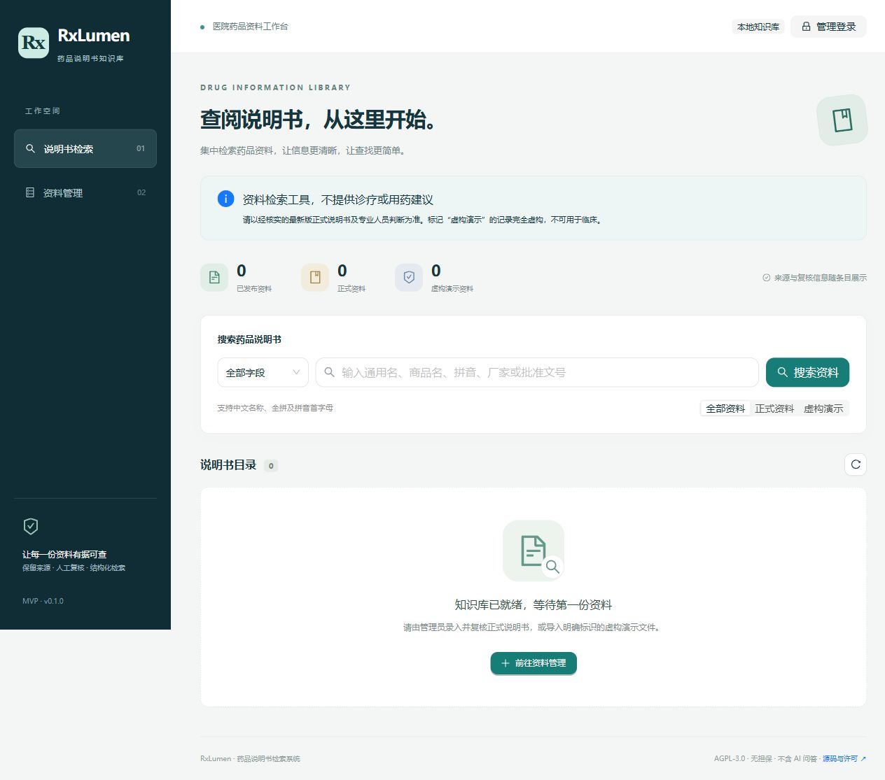
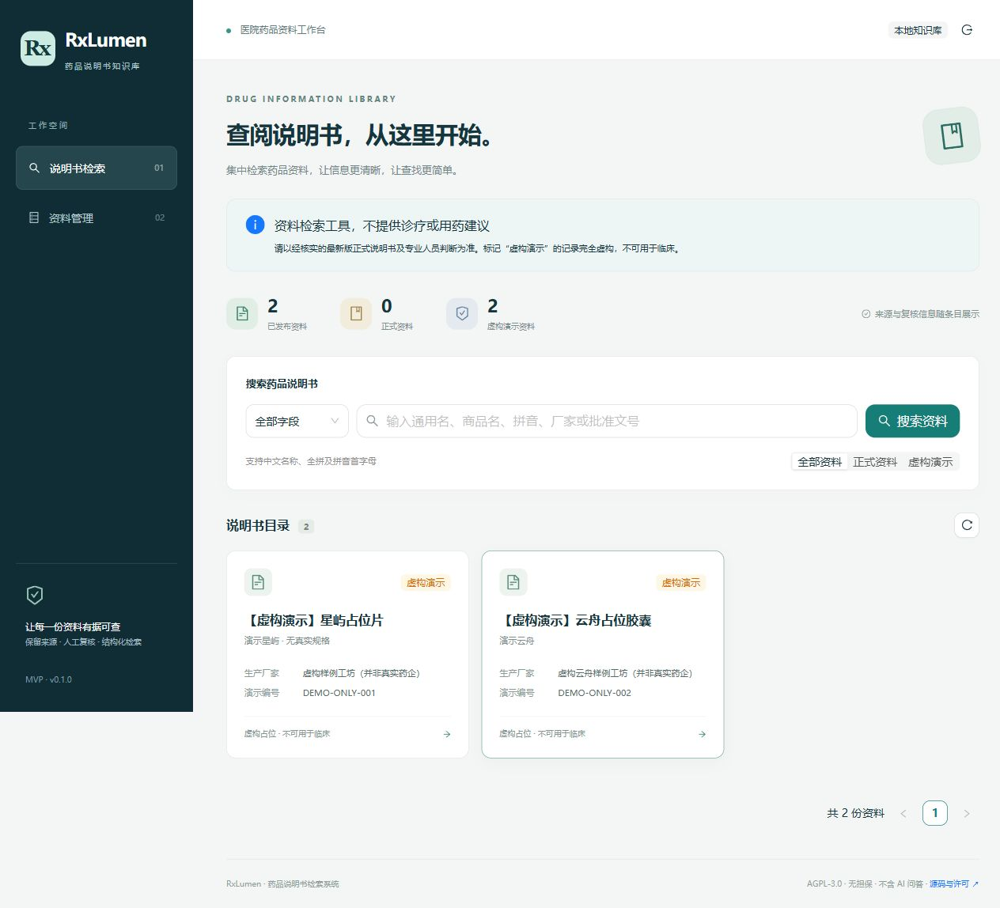
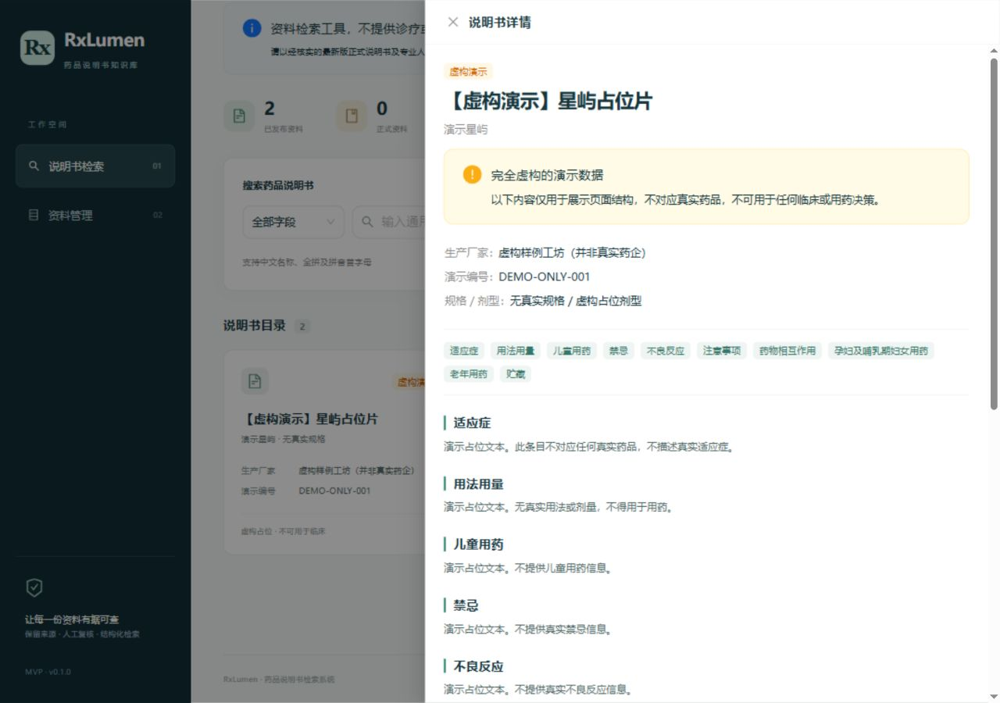

# RxLumen · 医院药品说明书检索系统

为院内药品资料建立一个轻量、清晰、可自行部署的检索入口。支持说明书结构化展示、人工维护、来源及复核记录，**当前不接入 AI 问答**。

**默认空库，不附带真实药品说明书。** 仓库中的两条 JSON 样例完全虚构，名称带有 `【虚构演示】` 前缀，编号以 `DEMO-` 开头，无真实药学含义，不可用于临床或用药决策。系统不会自动导入这些样例。

本项目采用 **AGPL-3.0-only**。AGPL 允许商业使用，不包含“未经授权禁止商用”条款；分发、修改和网络服务需遵守其源码提供等义务，详见[许可证说明](#许可证与依赖)。

## 功能

| 模块 | MVP 已实现 |
| --- | --- |
| 检索 | 通用名、商品名、自动生成的全拼及拼音首字母、生产厂家、批准文号的子串匹配；字段筛选、演示筛选和分页 |
| 说明书详情 | 适应症、用法用量、儿童用药、禁忌、不良反应、注意事项、相互作用、孕哺期用药、老年用药、贮藏 |
| 资料维护 | 单一管理员登录；新增、编辑、删除；草稿及发布状态；编辑和删除时检查记录版本，避免静默覆盖 |
| 来源与复核 | 来源名称、原始链接、说明书修订日期、复核人、复核日期、系统更新时间 |
| JSON 导入 | 文件选择或粘贴；先校验后导入；最多 200 条；整批事务写入；重复批准文号整批拒绝 |
| 空状态 | 默认空库、无搜索结果、错误重试、未录入栏目提示 |
| 部署 | SQLite 文件数据库；前后端开发启动；生产环境由 Express 同源提供前端；Docker 配置 |

正式资料发布前，服务器要求填写来源名称、复核人、复核日期及七个关键栏目。原文未载明时应如实填写“原文未载明”，不要补写推测内容。**这些校验只检查字段，不等于真实性认证或药师复核。**

## 界面预览

下图为软件实际运行截图；含资料的截图仅展示虚构样例。







## 技术栈

- 前端：React 19、Vite 7、TypeScript、Ant Design 6。
- 后端：Express 5、TypeScript、Prisma 6、SQLite。
- 校验与安全：Zod、Helmet、express-rate-limit、HttpOnly / SameSite Cookie、来源检查。
- 拼音：pinyin-pro。拼音在新增、编辑及导入时生成，无需手工维护。
- 测试：Node.js test runner、Supertest，使用独立临时数据库。

版本以 `package-lock.json` 为准。Prisma 固定在 6.19.3，以使用成熟的 SQLite 迁移流程；`deepmerge-ts` 覆盖为修复已知漏洞的 8.0.0，已通过实际迁移及集成测试。更新依赖后应重新跑全部检查。

## 快速开始

安装 [Node.js 22 LTS](https://nodejs.org/)（最低 22.12）、npm 和 Git。以下命令适用于 Windows PowerShell、macOS 和 Linux；如果 PowerShell 的脚本执行策略限制 `npm`，使用 `npm.cmd` 即可。

```sh
git clone https://github.com/clgf001/RxLumen.git
cd RxLumen
npm ci
npm run setup
npm run dev
```

打开 **http://127.0.0.1:5178**。前端固定为 5178，后端默认 3100，避免常见 5173 端口冲突。

`npm run setup` 会：

1. 在不存在 `.env` 时复制模板，并生成随机管理员密码；已有 `.env` 不会被覆盖。
2. 生成 Prisma Client，创建空 SQLite 文件并执行版本化迁移。
3. 保持药品表为空，不载入演示资料。

管理员密码位于本机 `.env` 的 `ADMIN_PASSWORD`。点击“管理登录”后输入密码即可管理资料。没有固定默认密码。请不要把 `.env` 或数据库上传到 GitHub。

停止开发服务：在启动终端按 `Ctrl+C`。再次启动：`npm run dev`。

### 首次体验

1. 查看默认空库；点击“管理登录”。
2. 如只需体验：进入“资料管理”→“导入 JSON”→下载虚构样例，再选择该文件。
3. 点击“校验数据”，确认通过后点击“确认导入 2 条”。此时才写入数据库。
4. 回到检索页，可试搜 `星屿`、`演示云舟`、`xingyu`、`xy`、`虚构云舟` 或 `DEMO-ONLY-001`。
5. 点开条目查看全部结构化栏目。演示标识在列表和详情中持续展示。

正式使用前，删除演示条目，录入具有合法使用权的说明书原文，完成院内人工复核后再发布。

## 资料录入与导入格式

新增时建议先存为草稿；草稿仅管理员可见。发布后可被所有能访问此服务的人检索。一个批准文号对应一个条目；MVP 不保存历史正文副本，更新通过版本号防止覆盖，并不能代替完整审计系统。

完整样例位于 [`client/public/import-example.json`](client/public/import-example.json)。文件为 **UTF-8 JSON 数组**，例如以下虚构草稿：

```json
[
  {
    "genericName": "【虚构演示】示例占位条目",
    "tradeName": "虚构商品名",
    "manufacturer": "虚构机构（非真实药企）",
    "approvalNumber": "DEMO-EXAMPLE-003",
    "indications": "虚构占位文字，不含真实适应症信息。",
    "dosage": "虚构占位文字，不提供任何剂量。",
    "sourceName": "人工编写的虚构测试样例",
    "isDemo": true,
    "status": "draft"
  }
]
```

| 字段 | 说明 |
| --- | --- |
| `genericName`, `manufacturer`, `approvalNumber` | 必填，名称/厂家最多 200 字，编号最多 100 字，编号全库唯一 |
| `tradeName`, `specification`, `dosageForm` | 商品名、规格、剂型，最多 200 字 |
| `indications`, `dosage`, `pediatric` | 适应症、用法用量、儿童用药 |
| `contraindications`, `adverseReactions`, `precautions`, `interactions` | 禁忌、不良反应、注意事项、相互作用 |
| `pregnancy`, `geriatric`, `storage` | 孕哺期用药、老年用药、贮藏；各正文栏目最多 12000 字 |
| `sourceName`, `sourceUrl` | 来源名称与可选原始链接；链接仅支持 HTTP/HTTPS |
| `revisionDate`, `reviewedBy`, `reviewedAt` | 原文修订日期、复核人、复核日期；日期格式 `YYYY-MM-DD` |
| `isDemo` | 布尔值，默认 `false`；虚构样例必须设为 `true` 并遵守名称/编号前缀规则 |
| `status` | `draft` 或 `published`，默认 `draft` |

每批 1–200 条，接口请求上限 2 MB，界面文件上限 1.9 MB（预留 JSON 包装空间）。不支持 CSV、Excel、PDF、OCR、直接抓取网页或覆盖式导入。导入碰到任何无效记录、文件内重复编号或库中已存在编号，整批拒绝；已有资料请在后台编辑。`id`、拼音、版本号和时间戳由系统生成，导入文件不能包含这些字段。校验后再确认导入时服务器会重新检查，不能跳过最终校验。

拼音是自动转换结果，可能受多音字影响；全拼可忽略空格、连字符、单引号和大小写，`ü` 转为 `v`。当前没有模糊纠错、全文相关度排名或多音字人工纠正功能。

## 配置

| 环境变量 | 本地默认值 / 用途 |
| --- | --- |
| `DATABASE_URL` | `file:./rxlumen.db`，**相对路径相对于 `prisma/`**，即 `prisma/rxlumen.db` |
| `ADMIN_PASSWORD` | 初始化随机生成；至少 16 个字符，登录接口最多接收 256 字符 |
| `HOST` | `127.0.0.1`，开发及本机生产默认只接受本机连接 |
| `PORT` | `3100`，Express 端口 |
| `APP_ORIGIN` | `http://127.0.0.1:5178`，浏览器访问的完整来源，不能带末尾 `/` 或路径 |
| `COOKIE_SECURE` | 本机 HTTP 为 `false`；HTTPS 部署必须为 `true` |
| `NODE_ENV` | 开发为 `development`，生产为 `production` |

如果更改开发后端端口，需要同时调整 `client/vite.config.ts` 的代理目标。用 `localhost`、IP、其他端口或域名访问时，`APP_ORIGIN` 也要与浏览器地址完全一致，否则写操作被拒绝。环境变更后重启服务。

## 检查与构建

```sh
npm run typecheck
npm test
npm run build
npm run smoke
npm run licenses
npm audit
```

`npm test` 自动创建并清理独立临时数据库，不使用日常数据库。测试覆盖空库、健康检查、非法参数、匿名访问、跨来源写入、登录与退出、发布要求、日期/URL 校验、事务导入、重复编号、多种检索、分页、草稿可见性、编辑/删除冲突和持久化。

`npm run smoke` 在构建后，使用隔离空库验证编译后的后端能同时提供 HTML、静态资源、JSON 样例、API、404 及安全响应头；不创建常驻服务，也不修改日常数据库。

构建结果：前端在 `dist/web/`，后端在 `dist/server/`，共享模块在 `dist/shared/`。已有 GitHub Actions 配置，每次推送或 PR 检查类型、测试、构建、依赖许可和生产依赖漏洞。

Windows 下请先停止正在运行的 RxLumen 后端再执行 `setup`、`build` 或 `db:generate`；Prisma 的数据库引擎文件运行时会被系统锁定，否则可能遇到 `EPERM`。停止服务后重试即可，不要删除数据库。

## 部署

### 本机或内网服务器

```sh
npm ci
npm run setup
npm run build
```

修改 `.env`：

```dotenv
NODE_ENV=production
HOST=127.0.0.1
PORT=3100
APP_ORIGIN=http://127.0.0.1:3100
COOKIE_SECURE=false
```

保留其他数据库和管理员密码配置，然后从项目根目录运行：

```sh
npm start
```

打开 **http://127.0.0.1:3100**。生产模式由 Express 同时提供前端和 API，不需要运行 Vite，不适合仅部署到 GitHub Pages 等纯静态托管。

面向院内多设备或正式域名时，用 Nginx/Caddy 等反向代理提供 HTTPS，并将 `APP_ORIGIN` 设为实际域名（如 `https://rx.example.org`）、`COOKIE_SECURE=true`。推荐继续将 Express 绑定到回环地址，由同机代理转发；不要把开发服务器直接暴露到公网。可按院内要求再加 VPN、访问控制和日志策略。所有正文读取默认不要求登录，管理写操作要求登录；不要上传内部敏感资料到可公开访问的实例。

生产运行建议使用 systemd、进程管理器或容器实现重启和运维。SQLite 适合单实例和轻量资料库，不要把同一个 SQLite 文件挂给多实例并发写入。

### Docker Compose

需要先安装 Docker Engine / Docker Desktop 和 Compose。可运行 `npm run setup` 生成 `.env`；若服务器只有 Docker，可手工复制 `.env.example` 为 `.env`，设置足够强的 `ADMIN_PASSWORD`，无需在主机执行 npm。

```sh
docker compose up -d --build
docker compose logs -f
```

打开 **http://localhost:3000**。Compose 仅将容器端口映射到主机回环地址，数据库保存在命名卷 `rxlumen-data` 中，不依赖容器生命周期。镜像首次启动自动迁移，运行用户为非 root。

通过 HTTPS 反向代理访问容器时，在 `.env` 加入 `DEPLOY_ORIGIN=https://实际域名` 和 `DEPLOY_COOKIE_SECURE=true`，再运行 `docker compose up -d`。这些是 Compose 的配置名，与直接 Node 部署的 `APP_ORIGIN` / `COOKIE_SECURE` 区分。停止服务使用 `docker compose down`；**不要随意使用 `down -v`，它会删除数据库卷**。

Docker 文件已提供；本次实际验证范围见 [`docs/verification.md`](docs/verification.md)，不要将未执行的容器构建视为已通过。

### 备份与升级

- 本机部署：先停止服务，复制 `prisma/rxlumen.db`（或实际 `DATABASE_URL` 指向的文件），再启动；如存在 `-wal` / `-shm` 辅助文件，不要在运行中仅复制主文件。
- 容器部署：先 `docker compose stop`，通过 Docker 卷备份方式保存 `rxlumen-data` 内容，再启动。定期验证恢复，不要将备份提交到公开仓库。
- 恢复：停止服务，先保留当前文件，再以备份替换实际数据库文件；确认文件权限后启动。
- 升级：先备份，再拉取代码，执行 `npm ci`、`npm run db:deploy`、`npm run build`，重启。迁移脚本随仓库提交，生产环境不要使用 `prisma migrate reset`。

## 数据安全与信息来源声明

1. 本项目仅是资料录入、存储、检索及展示工具，不是临床决策系统。请以经核实的最新版正式说明书、医疗规范和专业人员判断为准。
2. 不提供真实说明书数据库、疗效判断或用药建议；所有内置样例纯属虚构。未录入字段显示缺失提示，不表示无禁忌、无风险或可安全使用。
3. 使用者须确认资料来源、授权及适用地区，可从监管机构或厂家正式发布文件、合法授权资料、院内核验原件录入。软件许可证不等于药品资料的使用许可，不保证第三方资料可自由复制或再分发。
4. 请勿录入患者姓名、病历、处方或其他个人敏感信息。数据库、密码和备份默认已被 Git 忽略；提交前仍应自行检查文件清单。
5. 管理端采用单一管理员口令，Cookie 为 HttpOnly、SameSite=Strict，登录有效期 8 小时；会话保存在服务器内存，重启即失效。更换管理员密码后重启即可清除会话。无多用户、角色分权、双人审批或完整审计轨迹。
6. 有来源检查、请求大小限制、登录限流和安全响应头；没有配置跨站读取许可。限流默认按直接连接 IP 计数，未开启 `trust proxy`；在反向代理后多个用户可能共享额度，可由专业运维按实际代理拓扑配置，切勿直接信任所有转发头。
7. SQLite 文件并未加密，请使用操作系统权限、磁盘加密及独立备份控制访问。系统不自动联网抓取资料，也不向 AI 服务发送正文；访问手工录入的来源链接时则会打开对应外部网站。

## 许可证与依赖

原创代码依据 [`LICENSE`](LICENSE) 中的 **GNU Affero General Public License v3.0（SPDX: AGPL-3.0-only）** 提供。保留原仓库的许可证原文，并通过 `NOTICE` 记录项目通知。

- 允许使用、修改、分发和商业使用；没有额外的“非商业”限制。
- 分发须按协议保留通知、许可证并履行对应源码等义务。
- 修改版本通过网络与用户交互时，须按第 13 条显著向这些用户提供免费获取该版本对应源码的机会。界面底部已有“源码与许可”入口；部署自定义版本时请更新为**实际运行版本**的对应源码位置，不能只指向未经修改的上游。
- 软件不提供任何担保。上述是简要说明，完整义务以协议原文为准。参考 [GNU 使用指南](https://www.gnu.org/licenses/gpl-howto.html)、[AGPL 原文](https://www.gnu.org/licenses/agpl-3.0.html)。

本次实现没有复制其他项目的业务代码或真实药学数据。第三方 npm 包保持各自协议，许可声明及已安装包的原文通知见 [`THIRD_PARTY_NOTICES.md`](THIRD_PARTY_NOTICES.md)，锁定版本清单见 [`docs/dependency-licenses.json`](docs/dependency-licenses.json)。

本次锁文件审查包含直接、传递、开发及可选平台依赖；声明的协议为 MIT、ISC、BSD-2-Clause、BSD-3-Clause、0BSD、Apache-2.0，以及 `caniuse-lite` 浏览器兼容数据的 CC-BY-4.0。前述宽松代码协议可在保留要求的情况下与 AGPLv3 项目使用；CC-BY 数据保持自身协议、署名及链接，未作修改，不将数据冒称为本项目原创代码。[Apache 官方兼容说明](https://www.apache.org/licenses/GPL-compatibility.html)、[GNU 兼容性说明](https://www.gnu.org/licenses/license-list.html)、[CC-BY-4.0](https://creativecommons.org/licenses/by/4.0/)。

`npm run licenses` 为锁文件声明扫描与通知汇总，不是对每个依赖源文件的法律审计；新增依赖或复制外部代码时仍须核查源文件及随附通知。未知协议会使检查失败，需先人工审查。Docker 基础镜像及操作系统组件遵循各自条款，不包含在 npm 清单内。

## 项目结构

```text
client/                  React 页面、样式、虚构导入样例
server/src/              Express API、会话保护、查询和事务导入
server/test/             接口集成测试
shared/manual.ts         前后端共享字段及数据校验规则
prisma/                  数据模型、版本化迁移（本机数据库被忽略）
scripts/                 初始化、迁移、隔离测试及依赖许可检查
docs/                    截图、许可清单、验证记录
.github/workflows/       自动检查
```

## 后续计划：AI 问答及其他扩展

当前没有 AI、向量数据库或外部模型调用。后续可在资料质量和权限控制完善后再扩展：

1. 加入原始文件管理、历史版本、操作审计及多人复核，保持批准文号、厂家和版本关联。
2. 增加 CSV/Excel 映射预览、更多搜索能力及 PostgreSQL 部署路径。
3. 将**已发布且复核过的正式资料**按栏目切分，用带资料版本与原文引用的检索增强问答；默认排除演示和草稿。
4. 对无依据问题明确拒答；答案附来源、修订日期与复核记录，不生成无出处的剂量建议。
5. 模型服务、资料外发和访问权限由院方评估后配置，默认不向第三方发送院内资料。

欢迎通过 [Issues](https://github.com/clgf001/RxLumen/issues) 反馈可复现的软件问题；请勿附带患者数据、私有资料或管理员密码。
